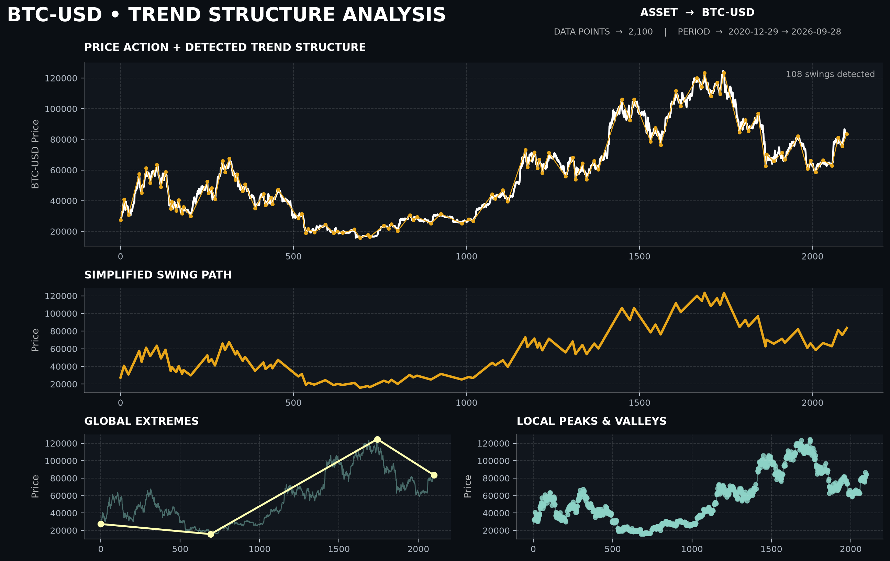
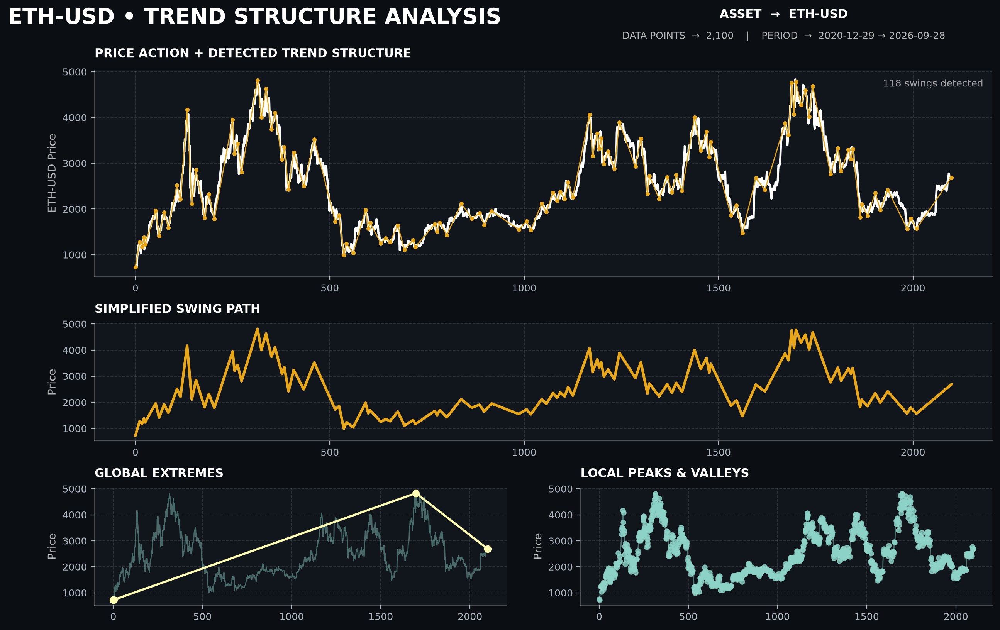
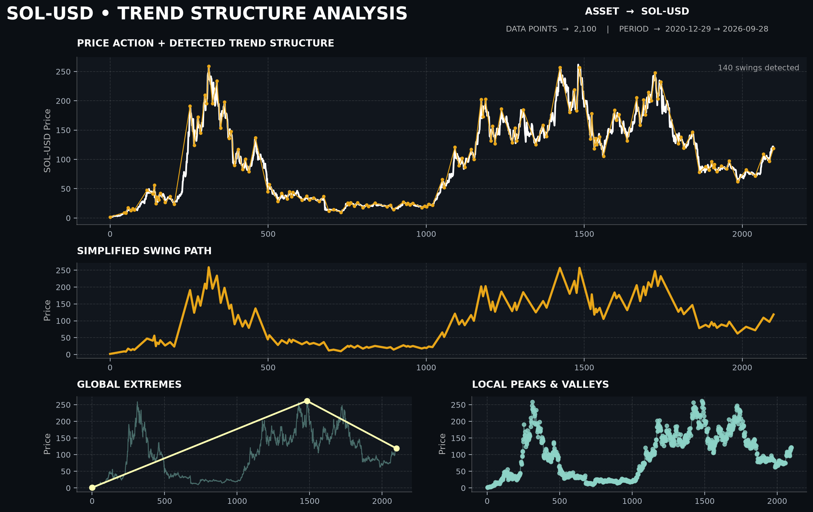

# Coin Trend Structure Analysis

A Python-based data analysis project for studying cryptocurrency price action through local peaks, valleys, and significant trend reversals.

The project converts raw price data into a simplified representation of market structure and visualizes the detected movements through a multi-panel analytical dashboard.

## Dashboard

The analysis generates a multi-panel dashboard for visualizing cryptocurrency market structure.

### Bitcoin



### Ethereum



### Solana



## Project Overview

This project analyzes historical cryptocurrency price data and attempts to simplify price action into a sequence of significant swing points.

The analysis includes:

* Local peak and valley detection
* Significant trend reversal detection
* Swing structure visualization
* Global high and low analysis
* Price action visualization
* Simplified trend-path visualization
* Custom analytical dashboard

## Data

Historical market data is retrieved using **Yahoo Finance** through the `yfinance` library.

The analyzed asset is controlled by the `ticker` variable:

```python
ticker = "BTC-USD"
```

Because the ticker is configurable, the same analysis can be applied to other supported cryptocurrency assets.

## Method

The project uses a simple rule-based approach to identify market structure.

### 1. Local Extremes

Local peaks and valleys are detected by comparing each closing price with its immediate neighbors.

A price is considered a local peak when:

```text
Previous Price < Current Price > Next Price
```

A price is considered a local valley when:

```text
Previous Price > Current Price < Next Price
```

### 2. Trend Reversal Threshold

Not every local movement is treated as a significant trend change.

A configurable threshold is used to confirm larger price movements:

```python
alpha = 0.04
```

This means that a reversal must move beyond the defined relative threshold before the trend structure changes.

### 3. Swing Structure

After detecting significant reversals, the selected swing points are connected to create a simplified representation of the asset's price structure.

This makes it easier to observe larger movements without focusing on every individual daily fluctuation.

## Visualization

The dashboard contains four analytical views:

### 1. Price Action + Detected Trend Structure

Displays the original closing-price series together with the detected significant swing structure.

### 2. Simplified Swing Path

Shows only the detected structural movements, providing a simplified view of the overall price path.

### 3. Global Extremes

Highlights the major high and low points across the selected period.

### 4. Local Peaks & Valleys

Displays the detected local extrema throughout the entire dataset.

## Example Assets

The analysis was tested on multiple cryptocurrency assets:

| Asset    | Ticker  |
| -------- | ------- |
| Bitcoin  | BTC-USD |
| Ethereum | ETH-USD |
| Solana   | SOL-USD |

## Project Structure

```text
Coin-Trend-Structure-Analysis/
│
├── images/
│   ├── btc_trend_dashboard.png
│   ├── eth_trend_dashboard.png
│   └── sol_trend_dashboard.png
│
├── src/
│   └── trend_analysis.py
│
├── .gitignore
├── README.md
└── requirements.txt
```

## Technologies

* Python
* NumPy
* Pandas
* Matplotlib
* yfinance

## Installation

Clone the repository:

```bash
git clone https://github.com/Amirreza-shamani/Coin-Trend-Structure-Analysis.git
```

Navigate to the project directory:

```bash
cd Coin-Trend-Structure-Analysis
```

Install the required dependencies:

```bash
pip install -r requirements.txt
```

## Usage

Open:

```text
src/trend_analysis.py
```

Change the ticker if needed:

```python
ticker = "BTC-USD"
```

For example:

```python
ticker = "ETH-USD"
```

Then run the script.

The analysis will download the historical data, detect local extrema and significant trend reversals, generate the dashboard, and save the resulting visualization inside the `images/` directory.

## Notes

This project is intended as an exploratory data-analysis and visualization tool.

The detected trend structure is based on predefined rules and thresholds. It should therefore be considered a simplified representation of price action rather than a complete trading or financial prediction system.

## Future Improvements

Possible future improvements include:

* Configurable analysis parameters
* Additional technical indicators
* More advanced swing-point detection
* Interactive visualizations
* Support for multiple assets in a single analysis
* Statistical comparison between different assets
* Additional market-structure metrics

## Author

**Amirreza Shamani**

Computer Science & Mathematics Student

GitHub: [Amirreza-shamani](https://github.com/Amirreza-shamani)
